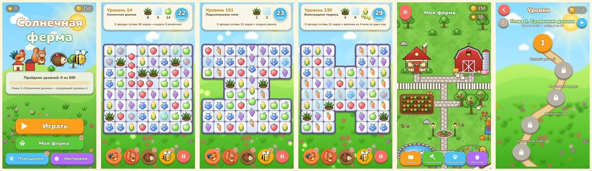

# Солнечная ферма

Офлайн-игра для Android: восстанавливай заброшенную ферму, проходя
головоломки «три в ряд» вместе с редкими, но очень полезными помощниками.

* Движок: **Godot 4.4.1-stable**, GDScript, рендерер GL Compatibility (2D).
* Платформа: Android 10+ (minSdk 21), портретная ориентация 9:16 с адаптацией
  под 20:9 и планшеты.
* Полностью офлайн: без аккаунтов, рекламы, аналитики, сетевых запросов и
  разрешений Android. Все ресурсы внутри APK, прогресс — на устройстве.



## Что есть в игре

**Головоломка 8×8** — шесть видов плодов (клубника, яблоко, кукуруза, морковь,
черника, виноград). Перемещение касанием или свайпом, возврат недопустимых
ходов, каскады, автоматическое перемешивание, подсказка хода, поле никогда не
стартует с готовым совпадением и всегда имеет допустимый ход.

**Усилители**

| Совпадение | Усилитель | Действие |
|---|---|---|
| 4 в линию | Ракета | очищает ряд или колонку |
| буква Т / Г | Корзина | взрыв 5×5 |
| 5 в линию | Радужная ягода | убирает все плоды выбранного типа |
| два усилителя местами | Суперкомбо | ракета+ракета — крест; ракета+корзина — 3 ряда и 3 колонки; корзина+корзина — 7×7; радуга+ракета/корзина — все плоды одного цвета превращаются в усилители; радуга+радуга — всё поле |

Усилитель срабатывает по касанию или при обмене с соседней клеткой.

**Помощники** (заряды ограничены, ход не тратят, перед применением показывают
способность и стоимость):

| Помощник | Способность | Старт |
|---|---|---|
| Петя-Петушок | склёвывает до 5 случайных обычных элементов | 2 |
| Белка Рыжуля | убирает выбранный элемент (или сорняк) | 2 |
| Ёжик Колючка | взрыв 3×3 вокруг выбранной клетки | 1 |
| Пчёлка Жужа | +3 хода (предлагается и при окончании ходов) | 1 |

Новые заряды: первое прохождение уровней 3, 5, 7, 9; первые три звезды на
каждом уровне; 10 заданий-достижений; бесплатный тестовый магазин. Таймеров
восстановления нет.

**500 уровней** в 25 главах. Первые 10 сделаны вручную (обучение), уровни
11–500 созданы генератором и каждый проверен ботом на проходимость без
помощников: 17 форм поля (крест, ромб, кольцо, сердце, арка, вырезы…),
сорняки, лёд (в том числе «толстые» — на два удара), цели по сбору, ракетам и
радуге, «сложные» уровни каждые 10. Звёзды считаются детерминированно: 1 — цель выполнена,
2 — с запасом ходов, 3 — с большим запасом и дополнительным условием уровня.
Подробности — [docs/GAME_DESIGN.md](docs/GAME_DESIGN.md).

**Эффекты**: глянцевые «конфетные» плоды, поле по форме уровня с мягкой
тенью, размытый фон с плавающими бликами, вспышка и «хлопок» при сборе, ударные
волны вокруг совпадений, сползание фишек в одну клетку при создании усилителя,
очистка волной вдоль ракеты и от центра взрыва, светящиеся лучи, звёздные
искры, полёт собранных плодов к цели по дуге со шлейфом, пульсирующее сияние
усилителей, падение поля в начале уровня, конфетти при победе. В режиме
«Простые эффекты» свечение и частицы отключаются.

**Ферма** — отдельная сцена с видом сверху, перетаскиванием и масштабированием
(щипком или колёсиком). 13 объектов: дом, амбар, забор, грядка, сад, дорожки,
фонари и клумбы, пруд, цветочная поляна, сарай/склад, мельница и загон на
новом участке (открываются уровнями 6 и 8), праздничное пугало — награда за
уровень 10. Каждый уровень улучшения меняет рисунок объекта, появляются
животные (куры, свинья, утки, корова, овцы), трава становится зеленее.

**Магазин** — бесплатные тестовые наборы зарядов с примером будущей цены в
рублях и пометкой «Тестовый режим». Реальных платежей нет; архитектура
(`PurchaseProvider`) позволяет позже подключить настоящую оплату.

## Быстрый старт

```bash
godot --path SolarFarm            # запуск в окне (450×800) на ПК
godot -e --path SolarFarm         # открыть в редакторе
```

Управление на ПК: мышь эмулирует касания; колесо — масштаб фермы.
Сборка APK — [BUILD_ANDROID.md](BUILD_ANDROID.md).

## Тесты

```bash
cd SolarFarm
godot --headless --path . --import
godot --headless --path . -s tests/run_tests.gd          # все наборы тестов
godot --headless --path . -s tests/sim_levels.gd -- 40   # баланс уровней 1–10
godot --headless --path . -s tools/generate_levels.gd -- 11 500 /tmp/levels.json  # перегенерация 11–500
python3 tools/merge_levels.py data/levels_generated.json /tmp/levels.json
```

Отчёт о проверке — [docs/TEST_REPORT.md](docs/TEST_REPORT.md).

## Структура

```
SolarFarm/
├── project.godot, export_presets.cfg
├── scenes/        MainMenu, Farm, LevelMap, Match3Board, LevelResult,
│                  HelperSelection, Shop, Settings
├── scripts/
│   ├── autoload/  GameManager, SaveManager, LevelManager, HelperManager,
│   │              FarmProgression, EconomyManager, AchievementManager, AudioManager
│   ├── match3/    BoardModel (логика), LevelGoals, Match3Controller, HUD, PieceView, FxLayer, Bot
│   ├── economy/   PurchaseProvider, FreeTestProvider
│   ├── farm/      сцена фермы
│   └── ui/        UIKit, экраны меню
├── assets/        tiles, helpers, farm, ui, fx, bg, fonts, shaders
├── audio/         sfx, music
├── data/          levels.json (1–10), levels_generated.json (11–500), helpers.json, farm.json, shop.json, achievements.json
├── saves/         описание формата сохранений
├── tests/         автотесты и симуляция баланса
├── tools/         генераторы графики и уровней, скрипты скриншотов
└── docs/          архитектура, геймдизайн, отчёт о тестах, лицензии, скриншоты
```

Архитектура — [docs/ARCHITECTURE.md](docs/ARCHITECTURE.md).
Ассеты и лицензии — [ASSETS_LICENSES.md](ASSETS_LICENSES.md).
История изменений — [CHANGELOG.md](CHANGELOG.md).

## Известные ограничения

* Игра **не проверялась на физическом Android-устройстве или эмуляторе** — в
  среде разработки их не было. APK собран и проверен статически (манифест,
  разрешения, подпись, ABI), сама игра проверена на Linux в том же движке
  (рендерер GL Compatibility, тот же, что на Android) при 720×1280, 540×1200 и
  900×1200.
* Безопасные отступы (вырезы экрана) берутся из `DisplayServer.get_display_safe_area()`
  и применяются только на мобильных устройствах; на реальных телефонах с
  нестандартными вырезами стоит проверить вид верхней панели.
* Баланс всех 500 уровней настроен по симуляции «жадного» бота (запас ходов
  ~55% от нужного боту); живые игроки играют иначе, поэтому после тестов с
  людьми может понадобиться подстройка коэффициентов в `tools/generate_levels.gd`.
* Монет за 500 уровней заметно больше, чем стоит полное восстановление фермы
  (≈4000): новых построек для поздних глав пока нет.
* Текстурные атласы не используются: текстур немного (≈100), рендерер
  Compatibility объединяет отрисовку 2D, просадок не наблюдалось.
* APK ≈ 62 МБ из-за двух архитектур движка (см. BUILD_ANDROID.md, как уменьшить).
* Музыка и часть звуков — сторонние CC0/MIT; синтезированные звуки помощников
  простые по звучанию.
